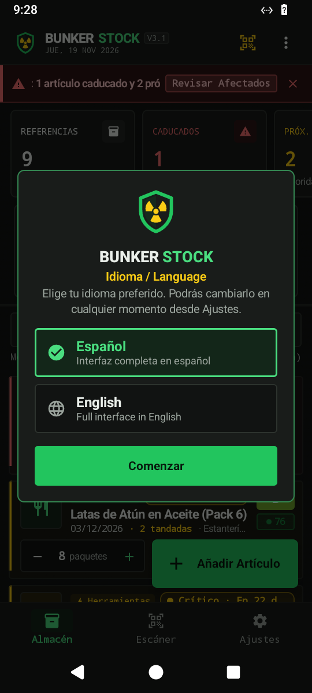
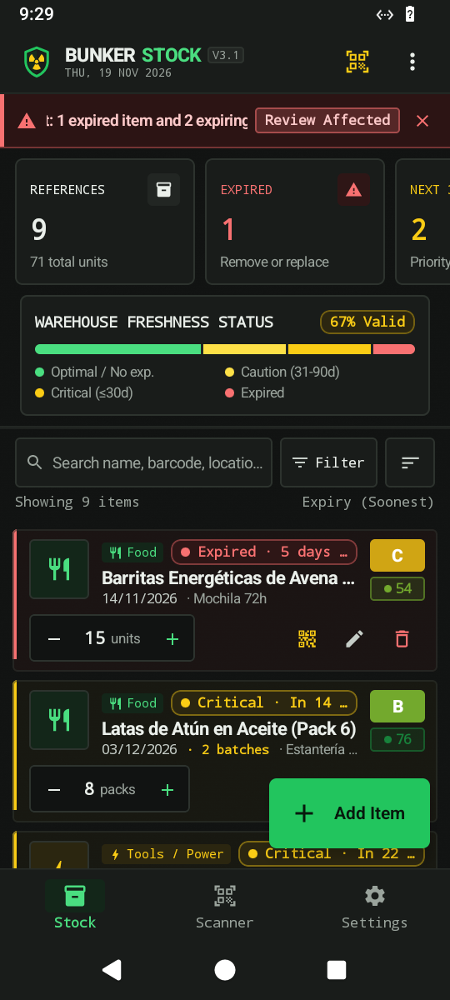
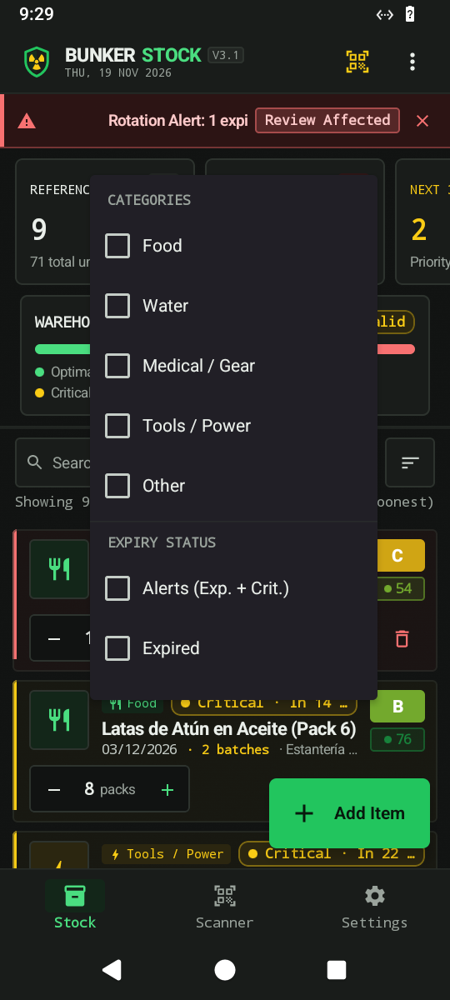
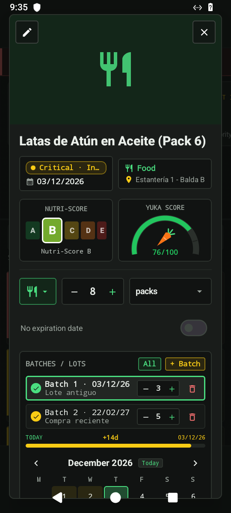
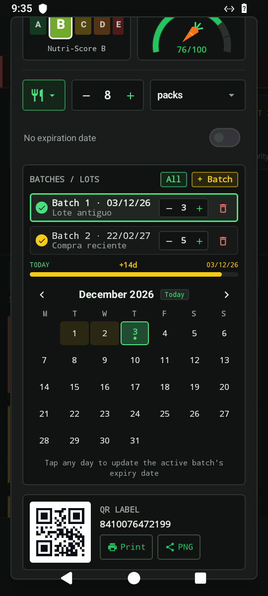
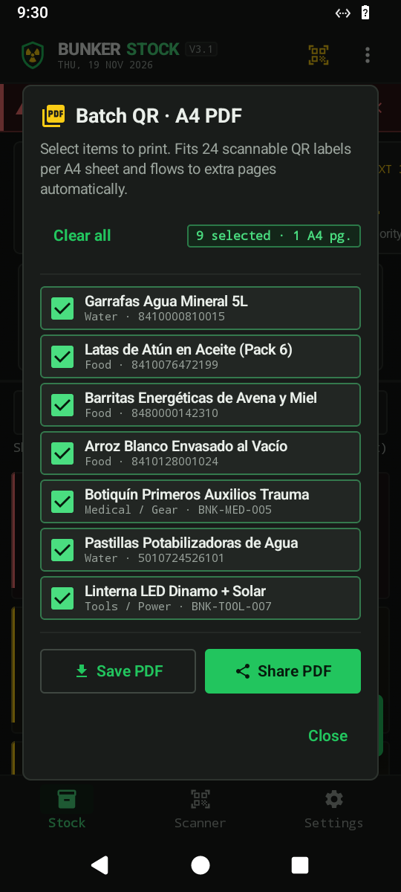
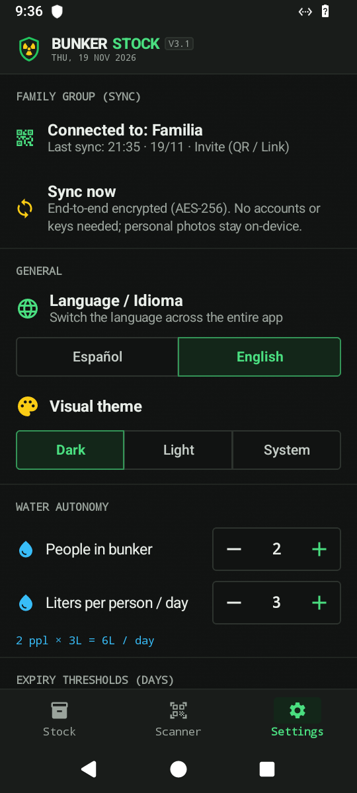
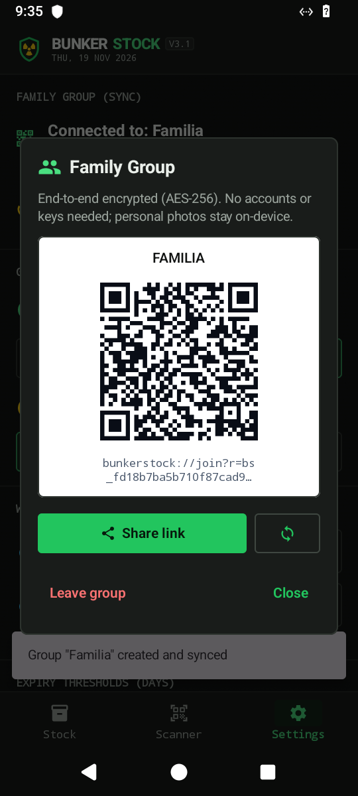

# BunkerStock (Android)

**BunkerStock** is a native Android app (Kotlin + Jetpack Compose + Material 3) for **offline-first household & emergency inventory management, expiration tracking, nutritional health scoring, and zero-account end-to-end encrypted family sync**, styled with a machined tactical concrete & Geiger-phosphor aesthetic.

---

## Screenshots

| First-Time Language Setup | Warehouse Dashboard | Multi-Select Checkbox Filter |
| :---: | :---: | :---: |
|  |  |  |

| Product Detail & BioShock Yuka Gauge | Multi-Batch Interactive Calendar | Batch QR · A4 PDF Export |
| :---: | :---: | :---: |
|  |  |  |

| Settings & Autonomy | E2E Encrypted Family Sync |
| :---: | :---: |
|  |  |

---

## Key Features

### Tactical Dashboard & Rotation Alerts
- **Auto-Scrolling Hazard Marquee**: Single-row compact rotation alert strip (`Expired` + `Critical` items) with one-tap *"Review Affected"* filter.
- **5 Actionable KPI Cards**: **References**, **Expired**, **Critical (customizable days)**, **Water Reserve** (auto-calculated liters + autonomy days based on people & daily liters), and **Food Units**.
- **Warehouse Freshness Bar**: Live segmented health indicator (`% Valid`) reacting dynamically to custom expiry thresholds.
- **Compact Single-Row Search & Multi-Filter**: Unified `40 dp` toolbar with instant search, a **checkbox dropdown filter** (multi-select categories + expiry statuses), and sorting.
- **Compact Inventory Rows**: Product photo thumbnail (auto-resolved from Open Food Facts / web or custom local image), quick `- / +` stock steppers, batch indicator, and stacked **Nutri-Score + Yuka health score** column on the right.

### Animated Product Detail & Multi-Batch Expiry Calendar
- Tap any product card to open an animated full detail view featuring:
  - **Hero Product Photo** with quick edit & close controls.
  - **Nutri-Score (A–E)** beside a **BioShock-inspired semicircular Yuka health gauge** with a custom vector carrot icon and `0–100` score.
  - **Quick inline controls**: Category icon dropdown (including **Other `?`**), quantity stepper, unit dropdown, and *"No expiration date"* toggle.
  - **Multiple Batches (*Tandadas*)**: Track separate purchases of the same product with different expiration dates and quantities; select which batch(es) to plot on the calendar.
  - **Interactive Expiry Calendar**: Visual approach trajectory shading the days between **Today** and your batch expiration date(s) — tap any day to update the active batch's date directly.
  - **Integrated QR Label, Placement & Notes**: Print or share PNG labels and edit bunker location/notes inline.

### Zero-Scroll Optical & QR Scanner
- **Bundled Offline ML Kit Barcode Scanner** (CameraX + Google ML Kit): Supports `QR`, `EAN-13`, `EAN-8`, `UPC-A`, `UPC-E`, `Code-128`, `Code-39`, and `GS1-128` `(17)YYMMDD` / `(10)LOT` extraction.
- **Fixed-Position Viewfinder Controls**: Scan QR from gallery image, flashlight toggle (anchored in place so switching cameras never shifts buttons), and front/back camera switcher.
- **Non-Blocking Detection Popup**: Camera stays live while showing Open Food Facts lookup, automatic shelf-life estimation, and nutritional scoring.

### Batch QR Labels to Multi-Page A4 PDF
- Pick any subset (or all) of your inventory and export a print-ready **A4 PDF** (`24 scannable ~30 mm QR labels per sheet` with dashed cut guides, auto-spilling onto additional pages when exceeded).
- Auto-generates persistent `BNK-XXXXXX` codes for unlabeled items and supports both **Save PDF** (SAF) and **Share / Print PDF**.

### Zero-Account Family Group Sync (E2E Encrypted)
- Create a family group in one tap and invite family members via **QR code or shareable `bunkerstock://join?...` link** — **no accounts, logins, or API keys required**.
- Snapshots are **GZIP-compressed and encrypted client-side with AES-256-GCM** using a secret key that stays inside the invite QR/link and never touches the relay in plaintext.
- Personal local photos stay on-device; remote devices automatically resolve standard product thumbnails on their own.
- Includes an optional self-hostable Cloudflare Worker in [`sync-worker/worker.js`](sync-worker/worker.js).

### Native Expiry Notifications, Custom Thresholds & Localization
- **Customizable Day Thresholds** in Settings for *Expired margin*, *Critical*, and *Caution*, dynamically updating KPIs, health bar, filters, and alerts.
- **Native Android Background Notifications** via WorkManager when confirmed items enter the dangerous expiry range.
- **First-Time Language Selector**: Clean **Español / English** choice on first launch (switchable anytime in Settings), plus **Dark / Light / System** themes.
- **Data Portability & Auto-Updates**: JSON backup export/import, Excel-ready UTF-8 CSV export, and read-only GitHub Releases update checker.

---

## Download & Install

Grab the latest signed release APK from **[GitHub Releases](https://github.com/Emefedez/bunker-stock-android/releases/latest)** (`BunkerStock-v3.1.apk`). All releases are signed with a persistent keystore so new versions install seamlessly in-place.

## Build & Test

```bash
./gradlew testDebugUnitTest assembleDebug
```

GitHub Actions automatically runs unit tests on every push to `main` and builds & publishes a signed release APK on `v*` tags.

---

## Credits

Created by **Emefedez**.  
Built with Android / Jetpack Compose, Material 3, CameraX, Google ML Kit, ZXing, Open Food Facts, GitHub Actions, `android-design-skills`, and the Google DeepMind team.
